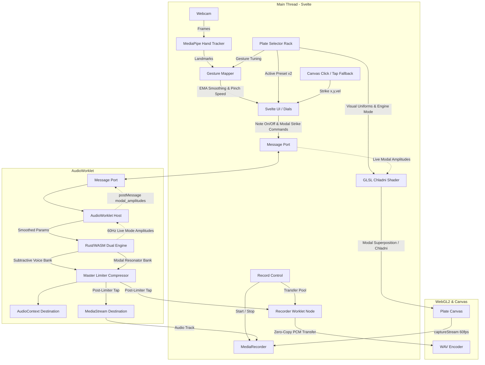

# Chladni: Polyphonic Synthesizer & Plate Visualizer


**Live Demo:** [Play Chladni](https://chladni.pages.dev) *(Requires Webcam and Audio permissions)*

[](https://github.com/Rajiv6165/chladni/actions/workflows/ci.yml)

Chladni is a browser-based, touchless polyphonic synthesizer and interactive cymatics visualizer. Using MediaPipe hand tracking, you can play chords and shape the sound with gestures in thin air. The audio engine runs entirely in a low-latency WebAssembly `AudioWorklet`, while the visuals accurately simulate Chladni plate resonance patterns using WebGL2—all happening fully client-side with no backend and zero cloud dependencies.

## Features
- 🖐️ **Touchless Gesture Control:** Play notes, strike plates, and adjust acoustic parameters using webcam hand tracking.
- 🎹 **Polyphonic WASM Synth Core:** Written in Rust and compiled to WebAssembly for zero-allocation, lock-free audio processing with both subtractive polyphonic voices and a physical modal resonator bank.
- 🔔 **Physical Modeling Modal Engine (Phase 9):** Simulates genuine 2D square plate vibration across 16–32 coupled damped modes ($f(n,m) = f_0 \frac{n^2+m^2}{2}$), spatial strike excitation ($\sin(n\pi x)\sin(m\pi y)$), and frequency-dependent damping ($\text{decay} \times \text{ratio}^{-\text{tilt}}$). Striking on a nodal line silences that mode both audibly and visually!
- 🌊 **Real-time Chladni Visualization:** A custom GLSL shader that computes the physical superposition of all live resonant modes, each weighted by its instantaneous amplitude from the Rust engine. Struck plates flash into complex geometric interference patterns and settle into fundamental modes.
- 🏷️ **Preset Plates (Phase 7 & 9):** 10 hand-tuned factory plates (6 subtractive + 4 physical modal plates) bundling sound, visual character, and gesture response with instant parameter ramping.
- 🎛️ **Brass Instrument Aesthetic:** An immersive, bespoke UI featuring custom SVG rotary dials adapting dynamically to active engine mode (Decay/Brightness vs Cutoff/Resonance).
- 🎙️ **Session Recording & Export (Phase 8):** Lossless 16-bit PCM WAV capture via zero-allocation `AudioWorklet` tapped after the master limiter, alongside synchronized 60fps canvas video (`MediaRecorder` with VP9/VP8/Opus or MP4 fallback).
- 🚀 **100% Client-Side:** No servers, no paid APIs. Runs securely in your browser.

## Tech Stack


## Architecture



### Why it's built this way
- **No-allocation audio path:** Both the Rust synthesis core and the PCM recording `AudioWorklet` run with zero heap allocations in their `process()` loops. Reusable transferable `Float32Array` buffers ping-pong between the main thread and audio thread, preventing GC dropouts.
- **Click-Free Parameter Ramping:** Switching preset plates mid-note transitions parameters (filter, delay time, feedback, oscillator waveforms, unison detune, and master gain) via one-pole smoothers, eliminating pops, clicks, or zippering.
- **Post-Limiter Tap:** Recording taps strictly *after* the master limiter compressor. Exported takes match what the user actually hears and can never clip harder than live playback.
- **AudioWorklet boundary:** The main thread sends structured parameter commands across the boundary, completely decoupling UI rendering and hand tracking from audio synthesis.
- **Chladni Plate Equation:** The visualizer uses the actual Chladni resonance equation (`sin(n*pi*x) * sin(m*pi*y) - sin(m*pi*x) * sin(n*pi*y) = 0`) to find nodal lines. The synthesizer's fundamental frequency is mapped to corresponding integer `(n, m)` resonance modes.
- **EMA Smoothing:** The gesture tracking uses Exponential Moving Average (EMA) to smooth out hand jitter before converting it into musical pitches and parameter values.

## Preset Plates (Phase 7 & 9)

A **"plate"** is an acoustic preset bundling the sound synthesis engine, the visual cymatics character, and the gesture response into a cohesive instrument identity. Switching plates feels like swapping out the vibrating metal plate on an acoustic instrument.

### Factory Plates (10 Plates)

| Plate | Engine | Sound Character | Visual Look | Gesture Tuning | Description |
|---|---|---|---|---|---|
| **Bell** | Subtractive | Pure sine wave, instant attack (5ms), enduring decay (800ms), long delay (450ms, 65% fdbk) | Ultra-sharp nodal lines (sharpness 2.6), minimal grain, crystalline lattice, pale antique ivory | Base octave 4 (MIDI 60), 2 octaves range, fine glissandi smoothing | Pure sinusoidal resonance with crystalline nodal lines and enduring bell decay. |
| **Glass Harmonica** | Subtractive | Triangle wave, swelling soft attack (150ms), sustained resonance, airy reverb | Medium line sharpness (1.4), fine sand grain (0.85), harmonic modal series, oxidized copper/verdigris | Base octave 4 (MIDI 60), 2 octaves range, high smoothing (0.22) for silky glissandi | Soft-edged ethereal friction tones with fine powder dispersion. |
| **Brass Drone** | Subtractive | Sawtooth wave, heavy detuned dual-oscillator unison (15 cents spread), warm low-pass filter (1800Hz) | Thick viscous nodal ribbons (sharpness 0.85), dense modal lattice, warm burnished brass tint | Base octave 2 (MIDI 36), low register, 2 octaves range | Heavy detuned dual-saw resonance with thick, viscous nodal ribbons. |
| **Pluck** | Subtractive | Band-limited PolyBLEP square wave, percussive zero-attack (2ms), snappy decay (120ms) | Crisp geometric lines (sharpness 2.0), low grain (0.15), concentric modes, slate patina tint | Base octave 3 (MIDI 48), 2.5 octaves range, agile responsive smoothing (0.08) | Percussive square-wave transient with snappy nodal settling. |
| **Deep Plate** | Subtractive | Triangle wave, dark low-pass resonance (500Hz), long slow delay (620ms), slight unison detune | Broad diffuse lines (sharpness 0.75), heavy acoustic bronze sand (grain 0.9), radial modes, dark bronze tint | Base octave 2 (MIDI 36), 1.5 octaves range, weighted smoothing (0.25) | Subterranean acoustic resonance vibrating heavy bronze grain. |
| **Shimmer** | Subtractive | Bright sawtooth, high filter cutoff (7500Hz), cascading delay trails (520ms, 82% feedback), 75% reverb mix | Intricate sharp lines (sharpness 2.8), fine glittering grain (0.95), crystalline modes, gilded brass tint | Base octave 4 (MIDI 60), 2.5 octaves range, responsive tracking | Scintillating high register with cascading echo trails and intricate geometry. |
| **Struck Glass** | **Modal** | High-Q coupled resonator bank, 24 modes, slow high-frequency decay (3.5s), bright impulse excitation | Crystalline sharp geometry (3.0), light sand dispersion (0.35), pale icy ivory tint | Base octave 4 (MIDI 60), responsive pinch-open strike trigger | Crystalline resonance with slow high-frequency decay and pristine nodal clarity. |
| **Bronze Gong** | **Modal** | Heavy 32-mode inharmonic modal bank, long fundamental decay (5.0s), deep metallic timbre | Thick dense acoustic ribbons (1.2), heavy grain dispersion (0.75), warm burnished brass tint | Base octave 2 (MIDI 36), weighted strike tracking | Heavy inharmonic spread with enduring fundamental resonance and dense particle dispersion. |
| **Wooden Plate** | **Modal** | Fast acoustic damping (0.8s), heavy tilt roll-off (1.6), dull warm strike transient, 16 modes | Broad organic low-order nodal ribbons (1.8), medium grain (0.5), warm organic timber tint | Base octave 3 (MIDI 48), snappy touch response | Rapid high-frequency damping with a dry, woody strike transient and broad low-order modes. |
| **Cymatic Bowl** | **Modal** | Ceramic singing bowl shimmer, 24 modes, medium-long decay (4.0s), rich modal interference | Delicately settled concentric patterns (2.4), fine shimmering dust (0.85), verdigris patina tint | Base octave 3 (MIDI 48), agile strike dynamics | Metallic singing bowl shimmer with rich modal interplay and delicate verdigris ripples. |

## Physical Modeling (Phase 9)

Rather than merely filtering an artificial waveform, Phase 9 introduces a genuine physical acoustic simulation of a vibrating 2D square plate.

### The Physics Approximation
- **Simply-Supported Square Plate:** The resonant mode frequencies obey $f(n,m) = f_0 \frac{n^2 + m^2}{2}$, where $(n, m) \in \mathbb{N}^2$ index the spatial eigenmodes. While real free-edge plates follow Kirchhoff-Love plate theory with non-integer Poisson ratios, simply-supported boundary conditions provide an exact analytic closed-form eigenbasis that maps 1-to-1 to the orthogonal 2D Chladni nodal equations.
- **Sorted Eigenmode Bank:** 32 precomputed mode pairs $(n, m)$ sorted by frequency ratio $(n^2+m^2)/2$ are preallocated per voice. Each mode is simulated by a 2-pole state-space coupled quadrature resonator with exact analytical decay $r^n$, unconditional stability ($r < 1.0$), and lag-free instantaneous energy readouts ($\sqrt{u^2+v^2}$).
- **Spatial Strike Projection & Nodal Line Silence:** When a plate is struck at normalized coordinates $(x, y) \in [0, 1] \times [0, 1]$, each mode's initial amplitude is projected onto the mode's spatial eigenfunction:
  $$W_{n,m}(x, y) = |\sin(n\pi x)\sin(m\pi y) - \sin(m\pi x)\sin(n\pi y)|$$
  Striking exactly on a nodal line where $\phi_{n,m}(x, y) = 0$ excites zero energy into that mode ($W_{n,m} = 0$). That mode is completely silent in the audio engine and absent from the WebGL2 visualizer.
- **Frequency-Dependent Damping:** High-frequency modes attenuate faster than fundamental modes according to the material's damping tilt:
  $$T_{60}(k) = T_{60,\text{base}} \times \left(\frac{1}{\text{ratio}_k}\right)^{\text{tilt}}$$
- **Live Modal Superposition in WebGL2:** At ~60 Hz, the AudioWorklet transmits the live amplitude vector $A \in \mathbb{R}^{32}$ to the visualizer via lightweight port messaging (compatible with GitHub Pages, no SharedArrayBuffer or COOP/COEP isolation required). The fragment shader evaluates:
  $$\text{Chladni}(x, y) = \frac{\sum_{k=1}^K A_k \cdot \phi_{n_k, m_k}(x, y)}{\sum_{k=1}^K A_k}$$
  Struck plates flash visibly into intricate high-order interference patterns and naturally resolve toward simple low-order modes as higher modes ring out.

### Performance Benchmarks (Phase 9)
- **Quantum Execution Time (8 voices, 32 modes = 256 coupled resonators):** ~62.8 µs per 128-sample quantum (~2.1% of the 2900 µs real-time audio budget at 44.1 kHz).
- **WASM Binary Size:** 66.1 KB (+10.9 KB delta from Phase 8's 55.2 KB).
- **JavaScript Bundle Size:** 269.0 KB (85.3 KB gzipped).
- **Sustained Rendering Rate:** 60 FPS under full modal superposition on hardware WebGL2.

### User Plates & Privacy
- **Local & Private:** User-created plates are stored directly on your machine in `localStorage`. No accounts, no backend, and zero remote data storage.
- **Save Current As:** Captures live synthesizer dials, visual settings, and gesture response under a custom designation (up to 36 characters with duplicate prevention).
- **Edit & Revert:** Tweaking dials marks a plate as `• MODIFIED`. The `[REVERT]` button snaps dials and audio parameters back to the loaded plate state.
- **Rename & Decommission:** User plates can be renamed or permanently decommissioned (with confirmation). Factory plates remain read-only.
- **Seamless Recording:** Switching plates while recording does not interrupt the active take or drop video frames.

### Import, Export & Share Schema
Plates can be exported as `.json` files or shared instantly through URL hashes (`#plate=<base64url>`). All imports are validated against a strict schema with automatic sanitization and clamping:

```json
{
  "version": 2,
  "id": "plate-struck-glass",
  "name": "Struck Glass",
  "description": "Crystalline resonance with slow high-frequency decay and pristine nodal clarity.",
  "category": "user",
  "engine": "modal",
  "modal": {
    "material": "glass",
    "decay": 3.5,
    "dampingTilt": 0.4,
    "brightness": 0.9,
    "modeCount": 24
  },
  "sound": {
    "waveform": "sine",
    "attack": 0.005,
    "decay": 0.5,
    "sustain": 0.5,
    "release": 1.0,
    "filterCutoff": 8000,
    "filterResonance": 0.3,
    "reverbMix": 0.5,
    "delayTime": 360,
    "delayFeedback": 0.45,
    "detune": 0.0,
    "masterGain": 1.0
  },
  "visual": {
    "lineSharpness": 3.0,
    "grainAmount": 0.35,
    "modeMapping": "crystalline",
    "tint": { "r": 0.82, "g": 0.86, "b": 0.90 }
  },
  "gesture": {
    "pitchRangeOctaves": 2.0,
    "baseOctave": 4,
    "smoothing": 0.1,
    "pinchThreshold": 0.05
  }
}
```

## Record & Export

Chladni includes a fully client-side recording system integrated into the brass control panel:

| Format | Container / MIME | Audio Encoding | Video Encoding | Primary Browser Target |
|---|---|---|---|---|
| **Lossless Audio** | `.wav` (`audio/wav`) | 16-bit PCM, native rate (e.g. 48kHz / 44.1kHz), stereo | N/A | Universal DAW / Audio player |
| **Synchronized Video (Preferred)** | `.webm` (`video/webm;codecs=vp9,opus` or `vp8`) | 192 kbps Opus stereo | VP9 / VP8, 60 FPS, 5 Mbps | Chrome, Firefox, Edge |
| **Synchronized Video (Fallback)** | `.mp4` (`video/mp4;codecs=avc1,mp4a.40.2`) | 192 kbps AAC stereo | H.264 / AVC, 60 FPS | Safari, iOS |

### Recording Safeguards & Privacy
- **Privacy-Safe Default:** By default, video recording taps exclusively the WebGL Chladni plate canvas via `canvas.captureStream(60)`. No webcam video, face, room, or hand footage is recorded. An explicit "INCLUDE INSET" toggle allows opting into a 60fps composite capture with the instrument frame and webcam inset.
- **Memory Bounded (3-Minute Ceiling):** Recordings are capped at 3 minutes (180s) to keep browser memory bounded (~34.5 MB for WAV, ~90 MB for video). A countdown warning appears at 2:30.
- **Tab Backgrounding Safety:** When switching tabs during a recording, the session automatically stops and finalizes immediately, preventing desynced or corrupt chunks caused by background audio suspension.
- **Zero Resource Leaks:** Discarding takes revokes object URLs and dereferences memory buffers immediately.

## Gesture Control Map

| Hand / Device | Action | Parameter Controlled | Range / Details |
|---|---|---|---|
| **Left Hand** | Pinch-Open (Release) | **Modal Strike** (Modal Mode) | Strikes the plate at hand position $(x, y)$ with velocity from open speed. |
| **Left Hand** | Pinch-Hold (Index + Thumb) | **Continuous Sustain** (Subtractive) | Sustains note in subtractive mode; release to note-off. |
| **Left Hand** | Move Y Axis (Up/Down) | **Pitch / Fundamental** | Tuned by active plate (e.g. C3–C5, C2–C4, or C4–C6). |
| **Right Hand** | Move Y Axis (Up/Down) | **Cutoff / Brightness** | Filter cutoff in subtractive mode; strike brightness in modal mode. |
| **Right Hand** | Move X Axis (Left/Right) | **Reverb Mix** | Controls delay/reverb wetness (0% to 100%). |
| **Mouse / Touch** | Click / Tap on Plate | **Direct Strike Fallback** | Strikes plate directly at $(x, y)$ without requiring a webcam. |

## Local Setup

Run this project locally in under 5 minutes:

### Prerequisites
- Node.js (v20+)
- Rust (`rustup` with the `wasm32-unknown-unknown` target)
- `wasm-pack`

### 1. Build the WASM Core
```bash
cd synth-core
# Install the webassembly target if you haven't already
rustup target add wasm32-unknown-unknown
# Build the WASM module
wasm-pack build --target web --out-dir ../app/public/pkg
```

### 2. Run the Svelte App
```bash
cd ../app
npm install
npm run dev
```
Open `http://localhost:5173` in your browser.

## Testing & Verification
```bash
# Run Rust synth-core unit tests (8 tests: waveforms, ADSR, feedback clamp, stability)
cargo test --manifest-path synth-core/Cargo.toml

# Run frontend Vitest suite (20 tests: WAV encoder, preset validation, storage, import/export)
cd app && npm test

# Type-check and lint
npm run check

# Production build
npm run build
```

## Known Limitations
- **Safari AudioWorklet Quirks:** Safari's implementation of AudioWorklet can occasionally be aggressive with sleeping background tabs.
- **GPU Delegate Support:** MediaPipe uses the GPU delegate where available. On some unsupported devices or strict browsers, it silently falls back to the CPU delegate, which may increase latency.
- **Lighting Sensitivity:** The gesture tracking accuracy is highly dependent on ambient lighting. Poor lighting will introduce jitter.
