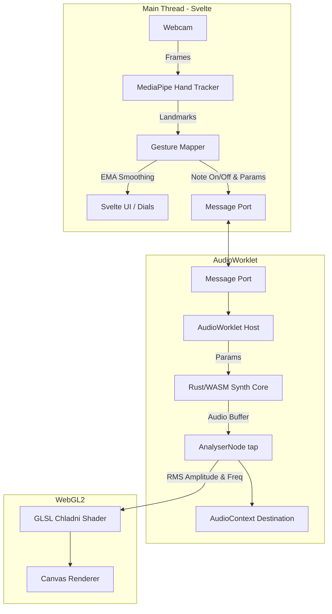

# Chladni: Polyphonic Synthesizer & Plate Visualizer


**Live Demo:** [Play Chladni](https://chladni.pages.dev) *(Requires Webcam and Audio permissions)*

[](https://github.com/Rajiv6165/chladni/actions/workflows/ci.yml)

Chladni is a browser-based, touchless polyphonic synthesizer and interactive cymatics visualizer. Using MediaPipe hand tracking, you can play chords and shape the sound with gestures in thin air. The audio engine runs entirely in a low-latency WebAssembly `AudioWorklet`, while the visuals accurately simulate Chladni plate resonance patterns using WebGL2—all happening fully client-side with no backend and zero cloud dependencies.

## Features
- 🖐️ **Touchless Gesture Control:** Play notes and adjust effects using webcam hand tracking.
- 🎹 **Polyphonic WASM Synth Core:** Written in Rust and compiled to WebAssembly for zero-allocation, lock-free audio processing.
- 🌊 **Real-time Chladni Visualization:** A custom GLSL shader that mathematically calculates Chladni resonance patterns driven directly by the audio output.
- 🎛️ **Brass Instrument Aesthetic:** An immersive, bespoke UI featuring custom SVG rotary dials and an oscilloscope-style webcam inset.
- 🚀 **100% Client-Side:** No servers, no paid APIs. Runs securely in your browser.

## Tech Stack


## Architecture



### Why it's built this way
- **No-allocation audio path:** The Rust synthesis core runs in the `AudioWorklet` with zero allocations on the audio thread, preventing garbage collection pauses that would cause audio glitching.
- **AudioWorklet boundary:** The main thread only sends lightweight JSON commands (Note On/Off, CC) across the boundary, completely decoupling UI rendering and hand tracking from audio synthesis.
- **Chladni Plate Equation:** The visualizer uses the actual Chladni resonance equation (`sin(n*pi*x) * sin(m*pi*y) - sin(m*pi*x) * sin(n*pi*y) = 0`) to find nodal lines. The synthesizer's fundamental frequency is mapped to corresponding integer `(n, m)` resonance modes.
- **EMA Smoothing:** The gesture tracking uses Exponential Moving Average (EMA) to smooth out hand jitter before converting it into musical pitches and parameter values.

## Gesture Control Map

| Hand | Action | Parameter Controlled | Range / Details |
|------|--------|----------------------|-----------------|
| **Left** | Pinch (Index + Thumb) | **Note On / Off** | Triggers note. Release pinch to stop. |
| **Left** | Move Y Axis (Up/Down) | **Pitch** | C3 (bottom of frame) to C5 (top of frame) |
| **Right** | Move Y Axis (Up/Down) | **Filter Cutoff** | Adjusts the low-pass filter cutoff |
| **Right** | Move X Axis (Left/Right)| **Reverb Mix** | Controls the delay/reverb wetness |
*Note: The right hand only affects sound while the left hand is actively pinching.*

## Local Setup

Run this project locally in under 5 minutes:

### Prerequisites
- Node.js (v18+)
- Rust (`rustup` with the `wasm32-unknown-unknown` target)
- `wasm-pack`

### 1. Build the WASM Core
```bash
cd synth-core
# Install the webassembly target if you haven't already
rustup target add wasm32-unknown-unknown
# Build the WASM module
wasm-pack build --target web --out-dir ../app/public/pkg
```

### 2. Run the Svelte App
```bash
cd ../app
npm install
npm run dev
```
Open `http://localhost:5173` in your browser.

## Known Limitations
- **Safari AudioWorklet Quirks:** Safari's implementation of AudioWorklet can occasionally be aggressive with sleeping background tabs.
- **GPU Delegate Support:** MediaPipe uses the GPU delegate where available. On some unsupported devices or strict browsers, it silently falls back to the CPU delegate, which may increase latency.
- **Lighting Sensitivity:** The gesture tracking accuracy is highly dependent on ambient lighting. Poor lighting will introduce jitter.
